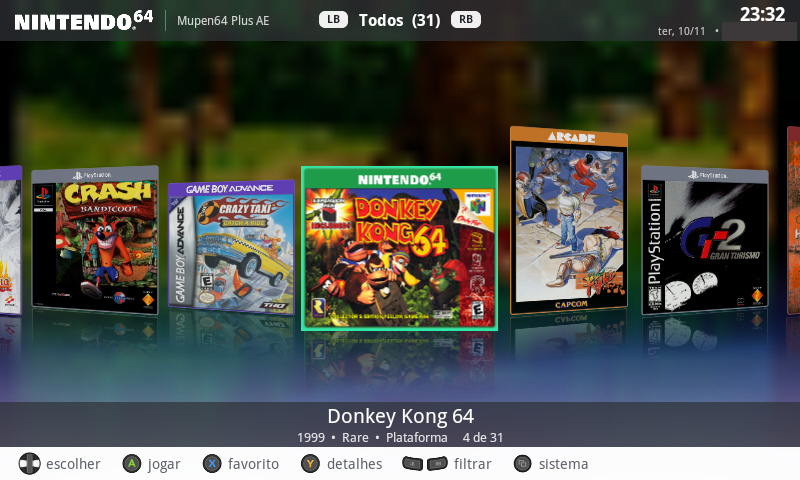
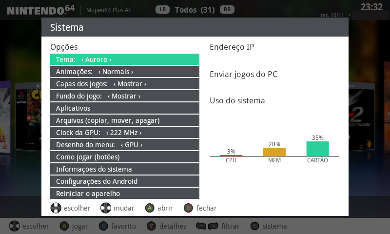
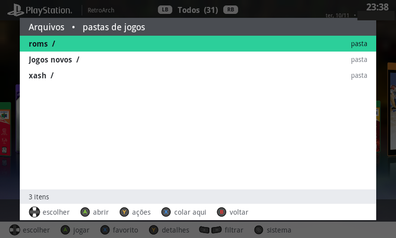
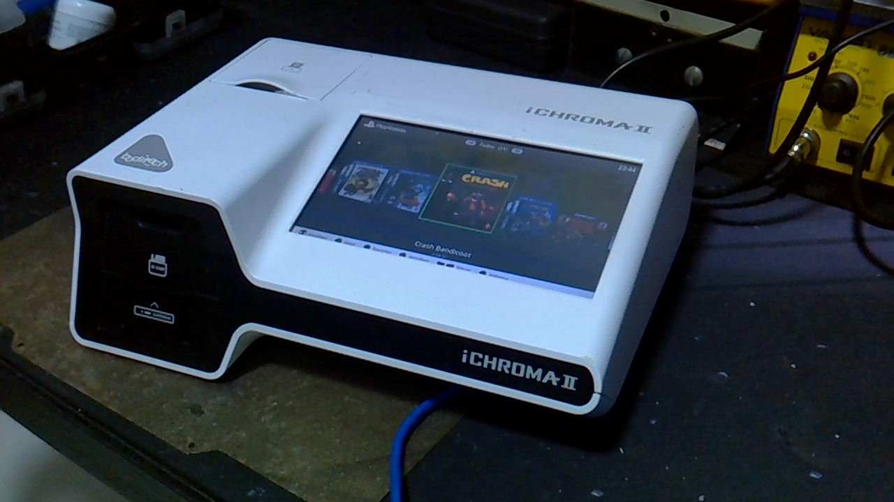
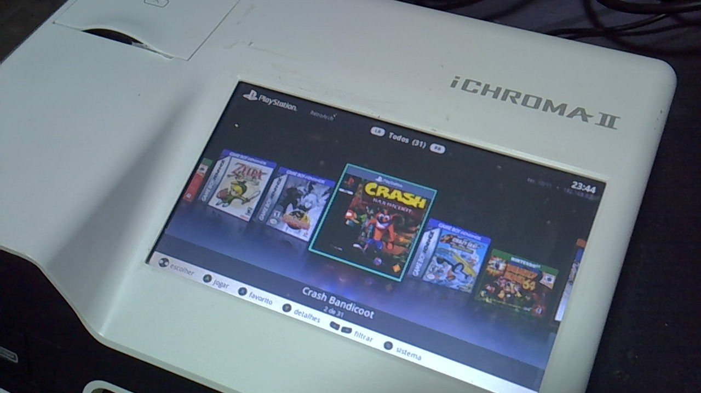
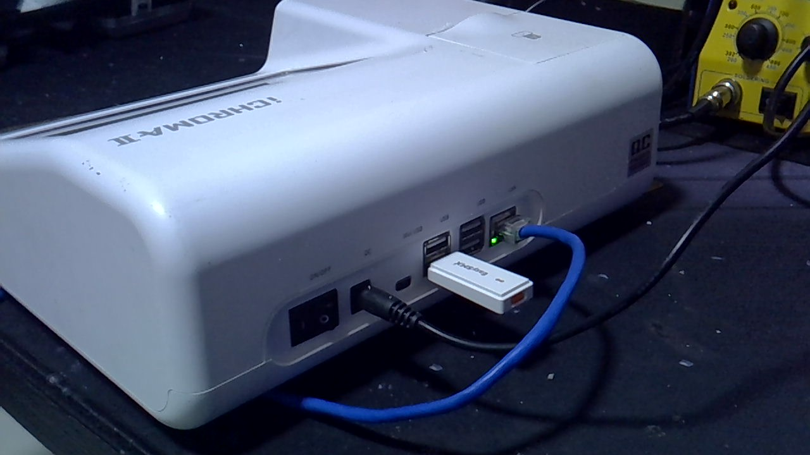

# ScrapCade: fliperama no Android 2.3

Menu de jogos (estilo "capas em carrossel") e driver de controle para um aparelho Android 2.3.3 com 512 MB de RAM,
processador S5PV210 de 1 GHz e saída de vídeo de 800x480, que foi reaproveitado como fliperama.

## T-OS e ScrapCade: o que é cada um

O projeto tem duas partes:

- **ScrapCade é o programa do menu.** É um app Android próprio (`com.thiago.launcher`), escrito em Java e instalado como qualquer app. Ele fica configurado como a tela inicial, por isso aparece quando o aparelho liga. Dá para atualizar ou desinstalar sem mexer no sistema.
- **T-OS é o sistema modificado.** É o Android 2.3 original do aparelho mais as mudanças que o transformam em fliperama:
  - **Driver do controle (`joyd`):** programa em C em `/system/xbin`, iniciado por um script de boot.
  - **Logo de inicialização:** gravado no bootloader e no kernel.
  - **Biblioteca de áudio muda:** trocada em `/system/lib`, porque a original trava o aparelho.
  - **Boot mais rápido:** apps de sistema pré-compilados.
  - **ADB pela rede:** ligado no sistema, para manutenção.

Este repositório tem o código do ScrapCade e do `joyd`. As modificações de bootloader, kernel e bibliotecas do sistema não estão aqui, porque dependem do firmware do aparelho.

## Diferenças em relação ao iChroma original

O aparelho é um iChroma II (analisador de laboratório, Boditech). O sistema original era clínico e fechado; esta versão é um fliperama.

| | iChroma II original | ScrapCade (esta versão) |
|---|---|---|
| Uso | analisador de imunoensaio, com dados de pacientes | fliperama, sem dados pessoais |
| Menu | telas do fabricante | menu de capas em carrossel, feito em OpenGL ES |
| Rede | não usada pelo usuário | IP na barra de cima; página no navegador (porta 8080) para enviar, apagar e trocar capas; ADB pela rede para manutenção (porta 5555); hora pela internet (NTP) |
| Som | alarmes e bipes de teste | **sem som**: a biblioteca de áudio original reinicia o aparelho (ver Limitações) |
| Controle | não tinha | controle USB Xbox 360, com o driver `joyd` |
| Jogos | não tinha | sistema por console: PS1, GBA, GB/GBC, NES, SNES, Mega Drive, N64, Neo Geo, arcade e PC (Half-Life e Doom) |

### Como funciona o modo "só jogar"

1. Copie o jogo para a pasta **Jogos novos** do cartão, ou ligue um pen drive no cabo OTG. Também dá para enviar pelo navegador (porta 8080).
2. O organizador move o arquivo para a pasta do console. Ele só mexe em arquivo que parou de crescer, para não pegar cópia pela metade.
3. Com a rede ligada, o menu baixa sozinho a capa e a imagem de fundo, e preenche ano, empresa e gênero. Sem rede, mostra o nome do jogo e o console.
4. Você escolhe o jogo com o controle e aperta A. O menu escolhe o emulador certo e abre direto no jogo, sem configurar nada.

## O que tem aqui

- `launcher/`: o app de menu (Java, Android 2.3). Carrossel de capas pela GPU, favoritos, mais jogados, fundo do jogo,
  gerenciador de arquivos pelo controle e pela página no navegador (porta 8080), e organizador da pasta "Jogos novos".
- `joypad/`: `joyd`, o driver do controle em C sem libc (roda como root no aparelho). Lê comandos de um arquivo
  (`game`, `ra <núcleo> <jogo>`, `n64 <jogo>`, `xash`, `hora`, `gpu`, `reboot`), converte o controle USB em teclas
  e abre os emuladores.
- `art_src/`: scripts que geram a arte e os índices de dados (CRC, nomes, metadados) a partir de fontes públicas.

## Emuladores usados

Nenhum emulador ou jogo está neste repositório. Os emuladores são instalados à parte:
RetroArch 0.9.9.6 com núcleos libretro (FB Alpha 2012, SNES9x 2005, PicoDrive, QuickNES, PCSX ReARMed, PrBoom),
Mupen64Plus AE 2.4.4, My Boy! Free e Xash3D.

## Limitações conhecidas

- O som está desligado: a biblioteca de áudio original do aparelho reinicia o sistema ao abrir um jogo com áudio.
- Nintendo 64 roda a 17–39 quadros por segundo, conforme o jogo. O analógico do controle funciona como direcional: o Android 2.3 não reconhece o eixo como joystick.
- Transferência por cabo USB não funciona na porta mini USB (ela aparece como adaptador serial). Use o pen drive na porta de cima ou a página na porta 8080.
- Final Fight (versão EUA de 1990) não roda no FB Alpha 2012: o núcleo só aceita outras revisões do jogo.

## Capturas

- `capturas/menu.png`: menu principal (carrossel de capas, barra de cima com o filtro e a hora).
- `capturas/painel_sistema.png`: painel "Sistema" (tema, animações, uso de CPU, memória e cartão).
- `capturas/arquivos.png`: gerenciador de arquivos pelo controle (copiar, mover, apagar, colar).

Fotos do aparelho (em `fotos/`): frente com o menu ligado, traseira com a porta de rede e o adaptador USB, e o menu ao vivo. A tela mostra capas de jogos de terceiros, a mesma ressalva das capturas.

### Menu principal



### Painel Sistema



### Gerenciador de arquivos



### Aparelho







As capas dos jogos e os logos dos consoles nas capturas são de terceiros.

## Inspirações

- **Aurora** (dashboard do Xbox 360): a ideia do carrossel de capas em destaque, com o título embaixo e o reflexo no chão, e a barra de cima com as etiquetas LB/RB para filtrar.
- **Batocera** (sistema de emuladores para PC e placas): a organização por pasta de console (`roms/<console>`) e a pasta de capas `images/` ao lado de cada jogo, com nomes iguais aos do acervo.

O desenho, as capas em carrossel e o código são próprios. Nenhum arquivo do Aurora ou do Batocera foi copiado.

## Plano futuro

Este projeto é um passo. A ideia maior é **reaproveitar equipamentos que iriam para o lixo** e dar a eles um uso útil, como fliperama ou computador de uso diário.

- **Sistema Linux no lugar do Android 2.3:** um sistema tipo Batocera (distribuição Linux para emuladores), com emuladores atualizados e suporte a mais hardware.
- **Interface tipo Aurora:** o mesmo carrossel de capas, mas com um front-end próprio que roda nesse sistema.
- **Equipamentos de sucata:** começar por aparelhos e computadores antigos que já estão parados, para dar uma segunda vida a eles.
- **Uso do dia a dia:** além de jogos, o mesmo sistema para navegar, assistir vídeos e ouvir música, em aparelhos que de outra forma seriam descartados.

Hoje nada disso existe ainda. O aparelho atual (iChroma II, Android 2.3) é o ponto de partida, e o que está aqui é o que já funciona nele.

## Como compilar

Precisa de Android SDK (build-tools 37), JDK e, para o driver, Zig 0.17.

```powershell
cd launcher; .\build.ps1      # gera launcher.apk
cd joypad;   .\build.ps1      # gera joyd (ARM estático)
```

O aparelho precisa estar com root e com o sistema alterado para aceitar o driver. Este repositório não traz isso.

## Licenças

- Ícones de sistema: libretro/retroarch-assets, CC-BY 4.0 (ver `launcher/assets/icons/CREDITOS.txt`).
- Botões: Xelu's Free Controller Prompts, CC0.
- Índices de CRC (`launcher/assets/crc`): derivados do libretro-database (metadados e nomes No-Intro), licença **CC BY-SA 4.0**. Estes arquivos seguem a mesma licença.
- Índice de nomes de Neo Geo e arcade (`launcher/assets/fbneo.idx`): derivado de listas de nomes do MAME/FBNeo, sem licença confirmada.
- Logotipos de consoles e marcas (Nintendo, Sega, Sony etc.) são de seus titulares e aparecem apenas para identificação. O tema de origem es-theme-carbon não tem licença confirmada.
- Capas de jogos que aparecem nas capturas e nas fotos são de terceiros e não fazem parte do código.
- Este projeto não tem fins lucrativos.
